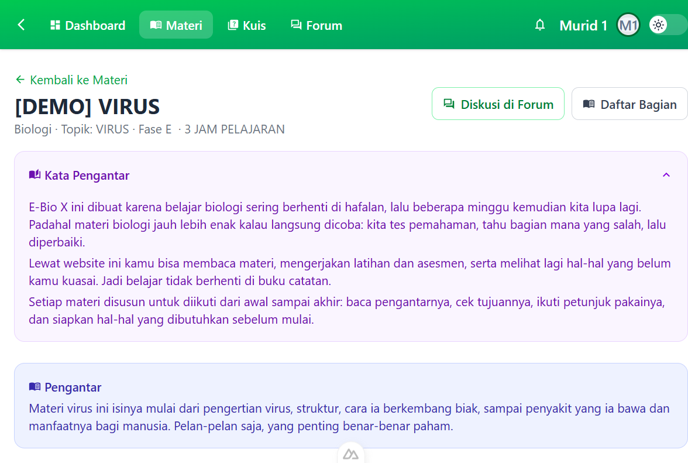
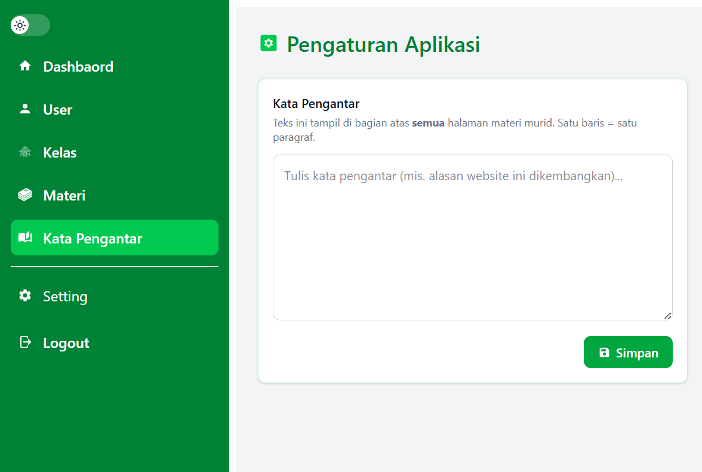
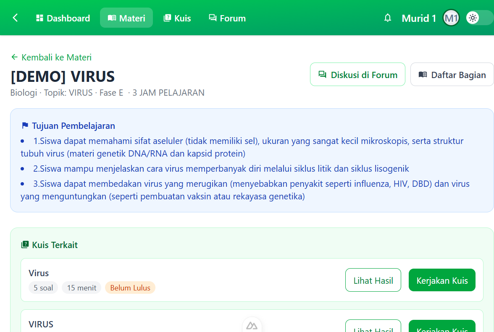
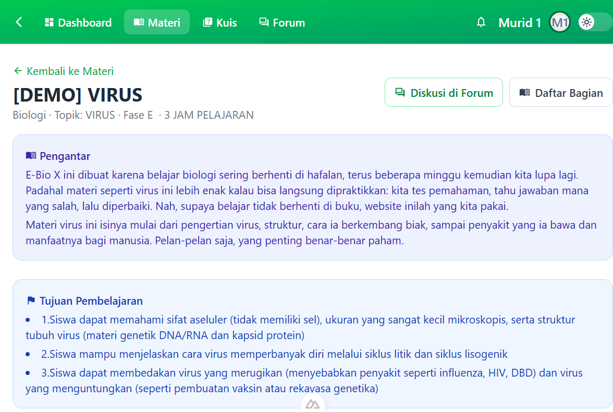
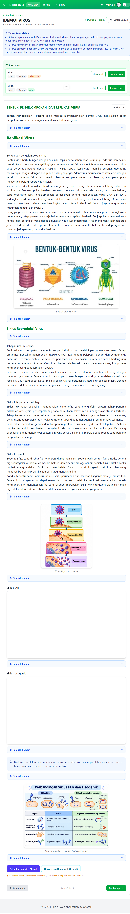
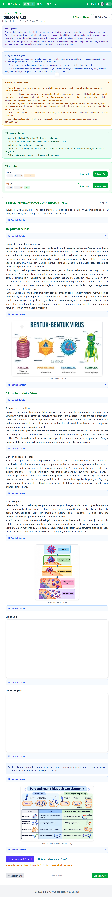
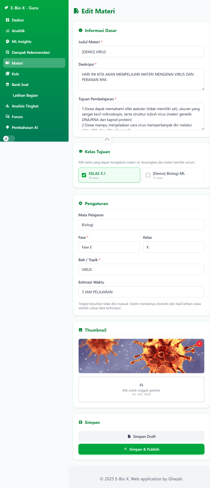
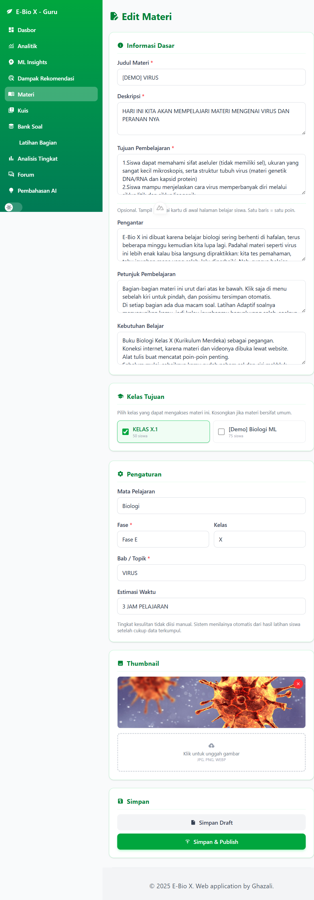

# Fitur: Pengantar, Petunjuk Pembelajaran & Kebutuhan Belajar

Dokumen ini menjelaskan fitur **kartu pembuka di halaman belajar siswa**:
*Kata Pengantar* (global, satu teks untuk semua materi), *Pengantar*,
*Petunjuk Pembelajaran*, dan *Kebutuhan Belajar* — beserta dokumentasi
**before/after**-nya.

Status: **selesai diimplementasikan** (backend + frontend), additive, dan
tidak mengubah perilaku fitur lain.

> **Pembaruan:** *Kata Pengantar* (alasan website ini dikembangkan) kini
> bersifat **global** dan otomatis tampil di **semua** materi. Lihat
> [Bagian 3](#3-kata-pengantar-global).

---

## 1. Ringkasan

Tiga informasi baru ditampilkan sebagai **kartu di awal halaman belajar
siswa**, tepat sebelum konten bagian:

| Urutan | Kartu | Sumber data | Warna |
|---|---|---|---|
| 1 | **Kata Pengantar** *(global, semua materi)* | `app_settings.foreword` | ungu (bisa dilipat) |
| 2 | **Pengantar** *(per materi)* | `materials.introduction` | indigo |
| 3 | **Tujuan Pembelajaran** *(sudah ada sebelumnya)* | `materials.learning_objectives` | biru |
| 4 | **Petunjuk Pembelajaran** | `materials.learning_guide` | kuning (bisa dilipat) |
| 5 | **Kebutuhan Belajar** | `materials.learning_needs` | hijau (bisa dilipat) |
| 6 | Kuis Terkait *(sudah ada sebelumnya)* | kuis materi | hijau |

Kartu hanya muncul bila datanya terisi (`v-if`), persis seperti pola
**Tujuan Pembelajaran** yang sudah ada.

### Makna masing-masing kartu

| Kartu | Isi sebenarnya |
|---|---|
| **Kata Pengantar** *(global)* | **Kenapa website ini dikembangkan** — alasan yang sama di semua materi (mis. belajar biologi sering berhenti di hafalan, jadi dibuat website yang bisa langsung dipraktikkan). Ditulis **sekali** oleh admin, tidak diulang per materi. |
| **Pengantar** *(per materi)* | Pengantar khusus materi itu: gambaran singkat isi materinya. |
| **Petunjuk Pembelajaran** | **Petunjuk penggunaan website** pada materi ini: urutan bagian, cara pindah bagian & penyimpanan posisi, dua jenis soal (Latihan Adaptif yang menyesuaikan vs Asesmen Diagnostik yang tetap), aturan **Asesmen Diagnostik tidak bisa dilewati** (tidak bisa pindah bagian sebelum 10 soal diagnostik selesai), Catatan, Forum Diskusi, dan Kuis Terkait. |
| **Kebutuhan Belajar** | **Apa yang diperlukan untuk belajar materi ini**: sumber rujukan, koneksi internet, alat tulis, pengetahuan prasyarat, dan perkiraan waktu. |

> **Catatan bahasa:** isi ketiga kartu ditulis dengan bahasa sehari-hari seperti
> yang mahasiswa biasa pakai — bukan bahasa formal yang terasa dibuat otomatis.
> Guru bebas menulis ulang dengan gaya sendiri; sistem tidak membatasi isinya.

### Keputusan desain (yang direkomendasikan)
1. **Format isi: teks biasa, satu baris = satu poin.**
   Konsisten dengan `learning_objectives`, mudah diisi guru tanpa editor,
   aman dari HTML/XSS, dan cukup untuk teks singkat. Kolomnya `TEXT`
   sehingga bisa ditingkatkan ke rich-text nanti tanpa migrasi ulang.
2. **Tampilan: Pengantar selalu terbuka; Petunjuk & Kebutuhan bisa dilipat
   (default terbuka).**
   Saat pertama dibuka semua informasi terlihat, tetapi siswa dapat
   merapikan halaman dengan melipat kartu yang sudah dibaca.

---

## 2. Skema data

Tiga kolom baru pada tabel `materials` (semua `TEXT NULL`):

| Kolom | Label UI | Isi | Wajib? |
|---|---|---|---|
| `introduction` | Pengantar | Narasi pembuka materi | Tidak |
| `learning_guide` | Petunjuk Pembelajaran | Langkah belajar | Tidak |
| `learning_needs` | Kebutuhan Belajar | Alat/bahan & prasyarat (ditulis guru) | Tidak |

Semua **nullable** sehingga materi lama tidak perlu diubah dan hanya
menampilkan kartu yang sudah diisi.

> **Penting:** fitur ini **tidak menambah "Bagian" (section)**. Karena itu
> ia **tidak memengaruhi** progres (x/y bagian), mastery per bagian, gerbang
> asesmen diagnostik, maupun graph prasyarat otomatis. Ini murni metadata
> tampilan.

Migrasi dijalankan otomatis oleh `ensure_schema_compat()` pada saat aplikasi
boot (lihat `src/config/database.py`), jadi database yang sudah ada akan
otomatis mendapat kolom baru tanpa perlu reset.

---

## 3. Kata Pengantar global

"Kenapa website ini dikembangkan" sama untuk semua materi, jadi tidak masuk
akal kalau harus ditulis ulang di tiap materi. Karena itu ia disimpan sebagai
**pengaturan aplikasi**, bukan kolom di `materials`.

### 3.1 Skema data
Tabel baru `app_settings` (key/value), satu baris untuk kunci `foreword`:

| Kolom | Tipe | Keterangan |
|---|---|---|
| `id` | INT (PK) | |
| `key` | VARCHAR(60) UNIQUE | `foreword` |
| `value` | TEXT | isi kata pengantar |
| `updated_at` | DATETIME | waktu perubahan terakhir |

Tabel dibuat otomatis lewat `ensure_schema_compat()`
(`_COMPAT_TABLES`, `CREATE TABLE IF NOT EXISTS`). Ini perlu karena
`db.create_all()` berjalan **sebelum** modul model diimpor, jadi tabel baru
tidak akan ikut terbuat dengan sendirinya pada database yang sudah ada.

### 3.2 API
| Method | Endpoint | Akses | Guna |
|---|---|---|---|
| `GET` | `/api/app-settings` | semua yang login | membaca `foreword` (dipakai halaman murid) |
| `PUT` | `/api/app-settings` | guru/admin | mengubah `foreword` |

### 3.3 Halaman admin
Menu **Kata Pengantar** (`/admin/settings`) menyediakan satu `textarea`
dengan tombol **Simpan**. Isinya langsung berlaku di semua materi.
(Menu baru di `AdminSidebar`.)

### 3.4 Perilaku di halaman murid
Halaman materi memanggil `GET /api/app-settings` saat dibuka. Bila
`foreword` terisi, kartu **Kata Pengantar** (ungu, bisa dilipat, default
terbuka) muncul di **paling atas**, di atas *Pengantar* per materi.
Bila kosong, kartu tidak muncul sama sekali.

### 3.5 Dokumentasi (tangkapan layar)

Halaman belajar murid — kartu **Kata Pengantar** (global) muncul di paling atas:



Editor di halaman admin (**Pengaturan Aplikasi → Kata Pengantar**):



### 3.6 File yang ditambahkan/berubah
| File | Perubahan |
|---|---|
| `e-bio-x-backend/src/models/app_setting.py` | model `AppSetting` (baru) |
| `e-bio-x-backend/src/services/app_settings_service.py` | get/set + `get_foreword`/`set_foreword` (baru) |
| `e-bio-x-backend/src/controllers/app_settings_controller.py` | `GET`/`PUT /api/app-settings` (baru) |
| `e-bio-x-backend/src/config/database.py` | `_COMPAT_TABLES` (buat tabel `app_settings`) |
| `e-bio-x-backend/src/__init__.py` | daftar 2 route baru |
| `e-bio-x-backend/src/models/__init__.py` | ekspor `AppSetting` |
| `e-bio-x-frontend/app/pages/admin/settings.vue` | editor Kata Pengantar (baru) |
| `e-bio-x-frontend/app/components/AdminSidebar.vue` | menu "Kata Pengantar" |
| `e-bio-x-frontend/app/pages/student/materials/[id].vue` | kartu Kata Pengantar global |

### 3.7 Isi contoh (global)
```
E-Bio X ini dibuat karena belajar biologi sering berhenti di hafalan, lalu beberapa minggu kemudian kita lupa lagi. Padahal materi biologi jauh lebih enak kalau langsung dicoba: kita tes pemahaman, tahu bagian mana yang salah, lalu diperbaiki.
Lewat website ini kamu bisa membaca materi, mengerjakan latihan dan asesmen, serta melihat lagi hal-hal yang belum kamu kuasai. Jadi belajar tidak berhenti di buku catatan.
Setiap materi disusun untuk diikuti dari awal sampai akhir: baca pengantarnya, cek tujuannya, ikuti petunjuk pakainya, dan siapkan hal-hal yang dibutuhkan sebelum mulai.
```

---

## 4. Dokumentasi Before / After

Screenshot ada di folder [`assets/pengantar-belajar/`](assets/pengantar-belajar/).

### 4.1 Halaman belajar siswa — kartu pembuka

**SEBELUM** — hanya ada kartu "Tujuan Pembelajaran":



**SESUDAH** — muncul "Pengantar" di atas dan "Petunjuk Pembelajaran" +
"Kebutuhan Belajar" di bawah Tujuan Pembelajaran:



Tampilan penuh (seluruh halaman):

| Sebelum | Sesudah |
|---|---|
|  |  |

### 4.2 Form guru (Buat/Edit Materi)

**SEBELUM** — kartu "Informasi Dasar" hanya berisi Judul, Deskripsi, dan
Tujuan Pembelajaran:



**SESUDAH** — bertambah tiga kolom opsional (Pengantar, Petunjuk
Pembelajaran, Kebutuhan Belajar):



---

## 5. Perubahan kode

Ringkasan (5 file untuk kartu pembuka per materi; +8 file untuk Kata
Pengantar global di [Bagian 3.6](#36-file-yang-ditambahkanberubah)):

| File | Perubahan |
|---|---|
| `e-bio-x-backend/src/models/material.py` | +3 kolom: `introduction`, `learning_guide`, `learning_needs` |
| `e-bio-x-backend/src/config/database.py` | +3 entri migrasi di `_COMPAT_COLUMNS` |
| `e-bio-x-backend/src/controllers/material_controller.py` | serializer detail (+3 field), create (+3 field), update (`editable` +3) |
| `e-bio-x-frontend/app/components/MaterialForm.vue` | +3 textarea di "Informasi Dasar", ikut di `form`/`loadDetail` |
| `e-bio-x-frontend/app/pages/student/materials/[id].vue` | +3 kartu (Pengantar, Petunjuk, Kebutuhan) + state lipat |

### 5.1 Backend — model
```python
# src/models/material.py
introduction   = db.Column(db.Text, nullable=True)
learning_guide = db.Column(db.Text, nullable=True)
learning_needs = db.Column(db.Text, nullable=True)
```

### 5.2 Backend — migrasi otomatis
```python
# src/config/database.py  (_COMPAT_COLUMNS)
('materials', 'introduction',   'ALTER TABLE materials ADD COLUMN introduction TEXT NULL'),
('materials', 'learning_guide', 'ALTER TABLE materials ADD COLUMN learning_guide TEXT NULL'),
('materials', 'learning_needs', 'ALTER TABLE materials ADD COLUMN learning_needs TEXT NULL'),
```

### 5.3 Backend — API
* `GET /api/materials/<id>` → mengembalikan `introduction`, `learning_guide`, `learning_needs`.
* `POST /api/materials` → menerima ketiganya (opsional).
* `PUT /api/materials/<id>` → ketiganya masuk daftar `editable`.

### 5.4 Frontend — form guru
Tiga `textarea` baru di kartu **Informasi Dasar** (opsional, satu baris =
satu poin). Nilai dimuat lewat `loadDetail()` dan ikut terkirim saat simpan.

### 5.5 Frontend — halaman siswa
Tiga kartu dirender dengan pola yang sama seperti kartu "Tujuan
Pembelajaran". Pengantar memakai paragraf; Petunjuk & Kebutuhan memakai
daftar berpoin dan bisa dilipat (`studyGuideOpen` / `learningNeedsOpen`,
default terbuka).

---

## 6. Cara guru mengisi (contoh nyata: materi **[DEMO] VIRUS**, id 107)

1. Buka **Materi → Edit Materi** (mis. `/teacher/materials/edit/107`).
2. Pada kartu **Informasi Dasar**, isi tiga kolom opsional. Satu baris = satu
   paragraf (Pengantar) atau satu poin (Petunjuk & Kebutuhan).
3. Simpan. Kartu langsung tampil di halaman belajar siswa.

### Pengantar per materi (1 paragraf)
```
Materi virus ini isinya mulai dari pengertian virus, struktur, cara ia berkembang biak, sampai penyakit yang ia bawa dan manfaatnya bagi manusia. Pelan-pelan saja, yang penting benar-benar paham.
```

> Bagian "kenapa website ini dikembangkan" **tidak lagi** ditulis di sini —
> sudah dipindah ke **Kata Pengantar global**
> ([Bagian 3](#3-kata-pengantar-global)), supaya tidak diulang tiap materi.

### Petunjuk Pembelajaran (5 poin)
```
Bagian-bagian materi ini urut dari atas ke bawah. Klik saja di menu sebelah kiri untuk pindah, dan posisimu tersimpan otomatis.
Di setiap bagian ada dua macam soal. Latihan Adaptif soalnya menyesuaikan kamu, jadi kalau jawabanmu banyak yang salah, soalnya bisa jadi lebih mudah. Asesmen Diagnostik soalnya tetap dan dipakai untuk mengukur tingkat kesulitan materi ini, jadi jawab sesuai pemahamanmu apa adanya.
Asesmen Diagnostik ini tidak bisa dilewati. Kamu baru bisa pindah ke bagian lain setelah semua soal diagnostik bagian yang sedang dibuka habis dijawab. Kalau dicoba pindah lebih dulu, akan muncul peringatan dan kamu diminta mengerjakannya dulu.
Kalau ada bagian yang susah, tulis di Catatan atau tanya di Forum Diskusi. Bagian yang ditandai lebih mudah dicari lagi nanti.
Kuis Terkait di atas materi sebaiknya dikerjakan setelah semua bagian selesai, sebagai gambaran akhir pemahamanmu.
```

### Kebutuhan Belajar (5 poin)
```
Buku Biologi Kelas X (Kurikulum Merdeka) sebagai pegangan.
Koneksi internet, karena materi dan videonya dibuka lewat website.
Alat tulis buat mencatat poin-poin penting.
Sebelum mulai, sebaiknya kamu sudah paham sel dan ciri makhluk hidup, karena virus ini sering dibandingkan dengan sel.
Waktu sekitar 3 jam pelajaran, boleh dibagi beberapa sesi.
```

---

## 7. Catatan teknis & hal yang perlu diperhatikan

* Fitur **additive**: tidak ada kolom/tabel yang dihapus atau diubah maknanya.
* **Tidak menyentuh**: `material_sections`, progres, `student_mastery`,
  `practice_answers`/`diagnostic`, rekomendasi, maupun graph prasyarat.
* Kolom lama (`description`, `content`) tetap seperti semula.
* Isi kartu di-*escape* otomatis oleh Vue (`{{ }}`), jadi aman dari HTML.

### Isu lama yang terlihat saat pengujian (bukan bagian fitur ini)
Saat aktivitas siswa memicu pelatihan latar belakang, log menampilkan:
`RuntimeError: Working outside of application context` pada
`src/controllers/learning_tracking_controller.py` (`_bg_train`). Ini bug
**yang sudah ada sebelumnya** pada thread pelatihan latar belakang, tidak
berkaitan dengan fitur kartu pembuka. Perlu ditinjau terpisah.
