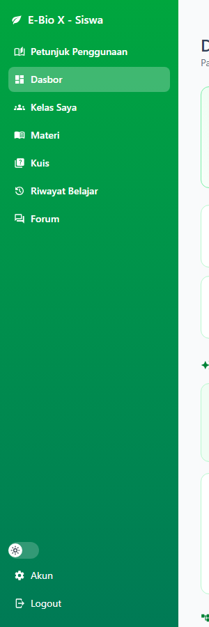
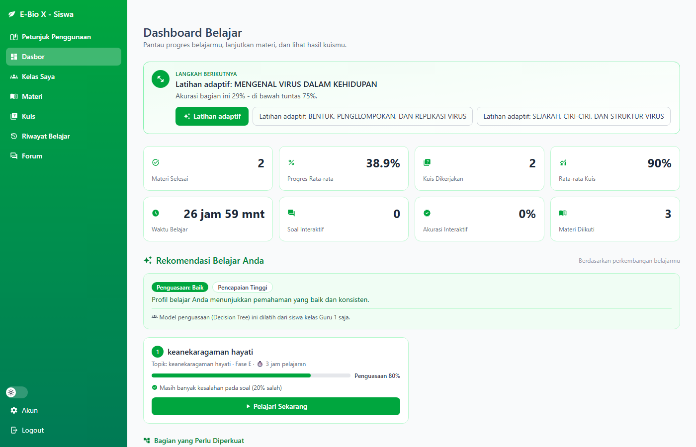
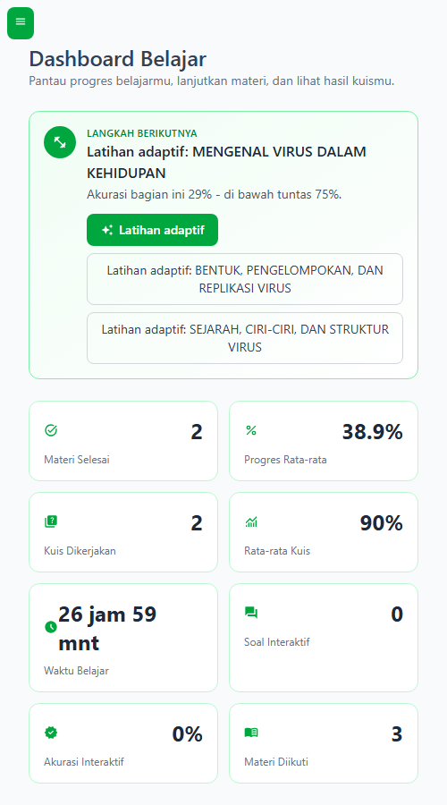

# Panduan Penggunaan Siswa — Dokumentasi Perubahan Navigasi (Before / After)

Dokumen ini mencatat dua perubahan pada navigasi siswa, beserta bukti tampilan
**sebelum (before)** dan **sesudah (after)**:

1. Penambahan menu **Petunjuk Penggunaan** (sebelumnya).
2. Perubahan navigasi dari **bar atas** menjadi **sidebar kiri vertikal** seperti milik guru (terbaru).

> **Status terkini:** siswa sekarang memakai **sidebar kiri** (`StudentSidebar.vue`),
> sama seperti sidebar guru — brand, menu vertikal, ToggleDark, Akun, dan Logout.
> Bar atas (NavBar) tidak lagi ditampilkan pada halaman-halaman siswa.

## Ringkasan perubahan terakhir (bar atas → sidebar kiri)

| Item | Sebelum | Sesudah |
| --- | --- | --- |
| Bentuk navigasi siswa | Bar atas (horizontal) + drawer ☰ | **Sidebar kiri vertikal** (256px) |
| Posisi menu di layar lebar | Di bar hijau atas | Di panel hijau kiri sepanjang layar |
| Konten halaman | selebar layar (mulai x=0) | digeser ke kanan **256px** (`sm:ml-64`) |
| Menu pertama | Petunjuk Penggunaan | **Petunjuk Penggunaan** (tetap paling atas) |
| Bar atas | tampil | **dihilangkan** pada halaman siswa |
| Layar sempit (< 640px) | tombol ☰ pembuka drawer | tombol ☰ pembuka **sidebar overlay** + tombol tutup ✕ |

Urutan menu sidebar siswa (dari atas):

`Petunjuk Penggunaan` → `Dasbor` → `Kelas Saya` → `Materi` → `Kuis` → `Riwayat Belajar` → `Forum`
→ (footer) `ToggleDark` · `Akun` · `Logout`

## Berkas kode yang diubah

**Perubahan terbaru (sidebar):**

- `e-bio-x-frontend/app/components/StudentSidebar.vue` — **baru**, sidebar siswa yang meniru
  `TeacherSidebar.vue` (menu vertikal, tombol ☰ mobile, overlay, tombol ✕, footer akun/logout).
- `e-bio-x-frontend/app/layouts/student.vue` — **baru**, layout yang me-mount `<StudentSidebar />`
  dan menggeser konten dengan `sm:ml-64`.
- 14 halaman `e-bio-x-frontend/app/pages/student/**` — ditambahkan `layout: "student"` di
  `definePageMeta` agar memakai layout sidebar tersebut.

**Perubahan sebelumnya (menu panduan):**

- `e-bio-x-frontend/app/components/NavBar.vue` — item `navLinks` peran `student` posisi pertama
  (kini hanya relevan untuk halaman ber-layout default, mis. `/account`).
- `e-bio-x-frontend/app/pages/student/panduan.vue` — halaman panduan siswa (12 bagian, bergambar).

## Perubahan terbaru: bar atas → sidebar kiri

**Before** — navigasi berupa bar atas dengan menu *Petunjuk Penggunaan* pertama:

**After** — sidebar kiri vertikal, menu *Petunjuk Penggunaan* tetap di posisi pertama:

Tampilan halaman penuh (sidebar + konten tergeser 256px):

## Layar sempit (mobile)

**Before** — drawer ☰ dari bar atas:

**After** — sidebar overlay terbuka lewat tombol ☰ (dengan tombol tutup ✕):

Keadaan tertutup (hanya tombol ☰ di kiri atas):

## Perubahan sebelumnya: menu panduan di bar atas

Tahap awal (sebelum sidebar), menu **Petunjuk Penggunaan** ditambahkan ke bar atas:

| Before | After |
| --- | --- |
|  |  |

| Before (crop) | After (crop) |
| --- | --- |
|  |  |

## Cara memverifikasi

1. Masuk sebagai siswa (contoh: `murid1@ebiox.com`).
2. Layar lebar: **sidebar kiri 256px** tampil dengan brand *E-Bio X - Siswa*, menu pertama
   **Petunjuk Penggunaan**, dan **tidak ada bar atas**.
3. Klik **Petunjuk Penggunaan** → terbuka `/student/panduan`.
4. Layar sempit: tombol ☰ di kiri atas membuka sidebar overlay; ✕ menutupnya.
5. Semua 14 halaman `/student/**` memakai sidebar yang sama (dicek otomatis pada 4 halaman
   representatif: dashboard, materials, panduan, quizzes — semua `sidebarExists: true`,
   `topNavGone: true`, `contentMarginLeft: 256px`).

## Tangkapan layar panduan fitur

Gambar panduan di aplikasi tersimpan di `e-bio-x-frontend/public/panduan-siswa/`
(12 berkas, `01-login.png` … `12-akun.png`) — **diambil dari situs produksi**
(`https://e-bio-x-nine.vercel.app`) setelah sidebar baru ter-deploy.

Salinan berkas tersebut juga tersedia di `docs/screenshots/` dengan prefiks
`panduan-siswa-01-login.png` … `panduan-siswa-12-akun.png`.

Bukti navigasi (before/after) tersimpan di:

- `docs/assets/panduan-siswa/` — dipakai oleh dokumen ini.
- `docs/screenshots/navigasi-siswa-*.png` — salinan untuk lampiran.
