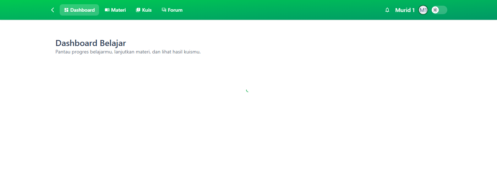
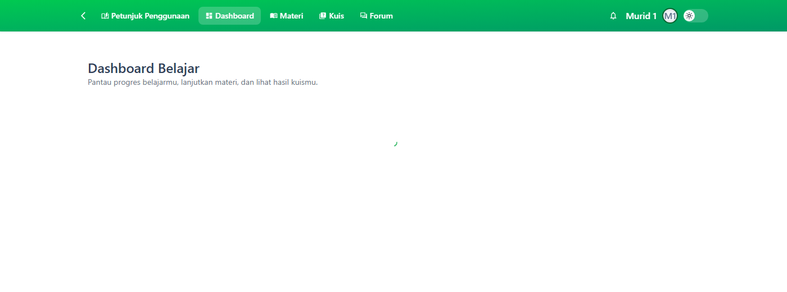
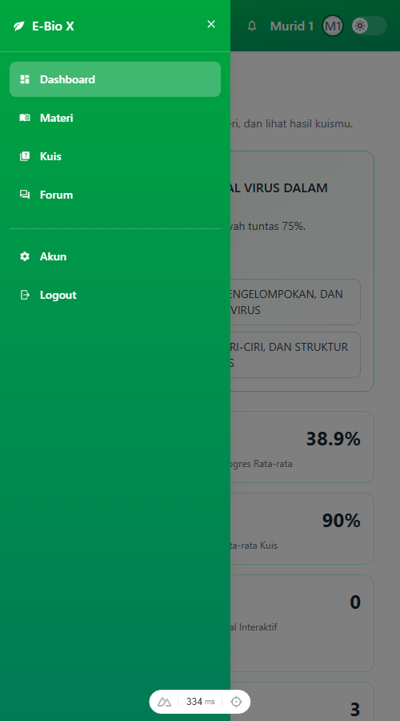
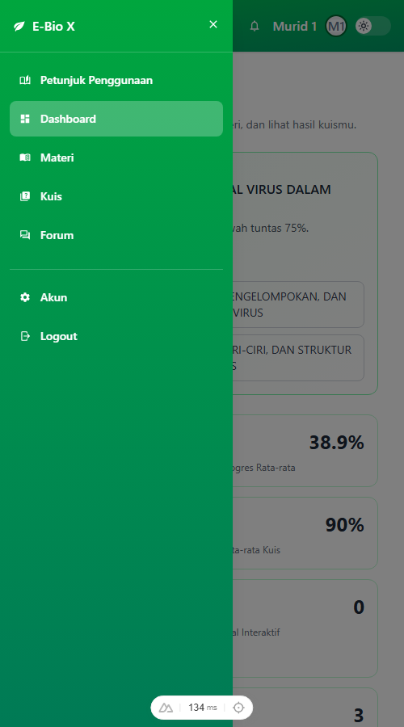

# Panduan Penggunaan Siswa — Dokumentasi Perubahan Navigasi (Before / After)

Dokumen ini mencatat penambahan menu **Petunjuk Penggunaan** pada navigasi siswa
beserta bukti tampilan **sebelum (before)** dan **sesudah (after)**.

> Catatan: siswa **tidak** memakai sidebar kiri seperti guru. Navigasi siswa berupa
> **bar atas** (desktop) dan **drawer ☰** (layar sempit/mobile). Karena itu dokumentasi
> before/after dibuat untuk kedua bentuk tersebut.

## Ringkasan perubahan

| Item | Sebelum | Sesudah |
| --- | --- | --- |
| Menu navigasi siswa (desktop) | Dashboard · Materi · Kuis · Forum | **Petunjuk Penggunaan** · Dashboard · Materi · Kuis · Forum |
| Menu drawer (mobile) | E-Bio X · Dashboard · Materi · Kuis · Forum · Akun · Logout | E-Bio X · **Petunjuk Penggunaan** · Dashboard · Materi · Kuis · Forum · Akun · Logout |
| Halaman baru | — | `/student/panduan` (Panduan Penggunaan Siswa) |

Menu **Petunjuk Penggunaan** diletakkan di **posisi pertama**, sebelum *Dashboard*.

## Berkas kode yang diubah

- `e-bio-x-frontend/app/components/NavBar.vue` — menambahkan satu item `navLinks` untuk
  peran `student` pada posisi pertama.
- `e-bio-x-frontend/app/pages/student/panduan.vue` — halaman panduan siswa (12 bagian,
  bergambar).

## Tampilan bar atas (desktop)

**Before** — belum ada menu "Petunjuk Penggunaan":

**After** — menu "Petunjuk Penggunaan" muncul paling depan:

Tampilan bar atas beserta awal halaman (top):

| Before | After |
| --- | --- |
|  |  |

## Tampilan drawer (mobile)

**Before** — teks menu: `E-Bio X · Dashboard · Materi · Kuis · Forum · Akun · Logout`

**After** — teks menu: `E-Bio X · Petunjuk Penggunaan · Dashboard · Materi · Kuis · Forum · Akun · Logout`

## Cara memverifikasi

1. Masuk sebagai siswa (contoh: `murid1@ebiox.com`).
2. Pada layar lebar: bar atas menampilkan **Petunjuk Penggunaan** sebagai menu pertama.
3. Pada layar sempit: buka menu **☰**, item **Petunjuk Penggunaan** muncul paling atas.
4. Klik menu tersebut → terbuka halaman `/student/panduan`.

## Tangkapan layar panduan fitur

Gambar panduan di aplikasi tersimpan di `e-bio-x-frontend/public/panduan-siswa/`
(12 berkas, `01-login.png` … `12-akun.png`).
