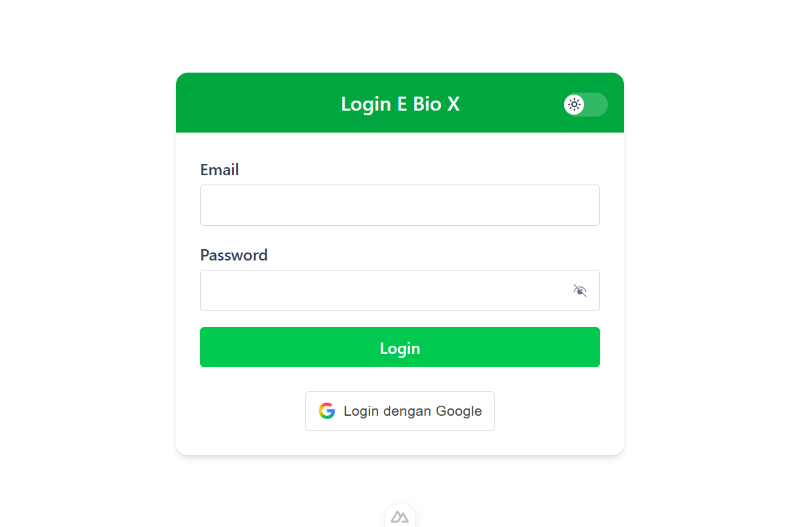
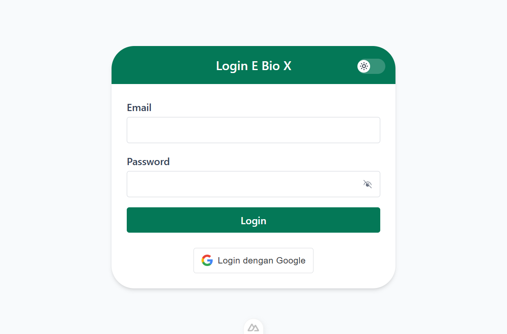
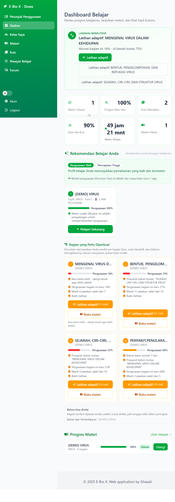
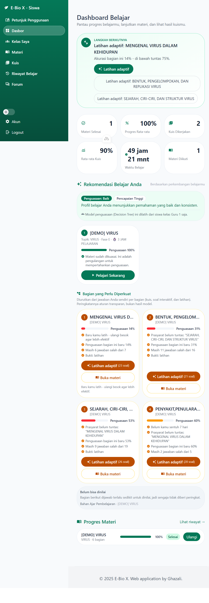
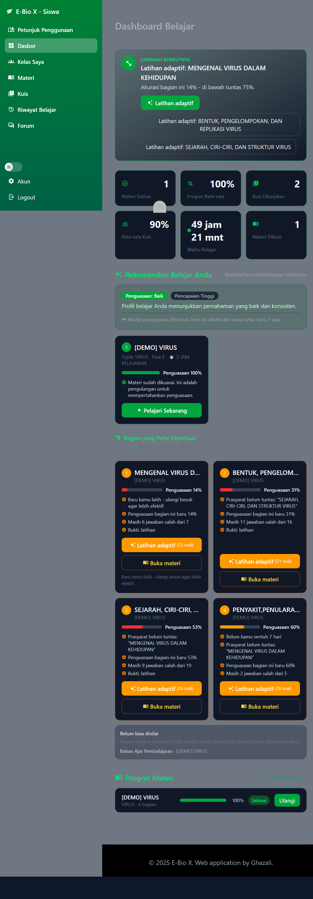
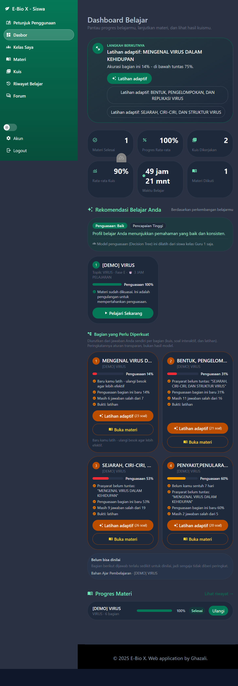
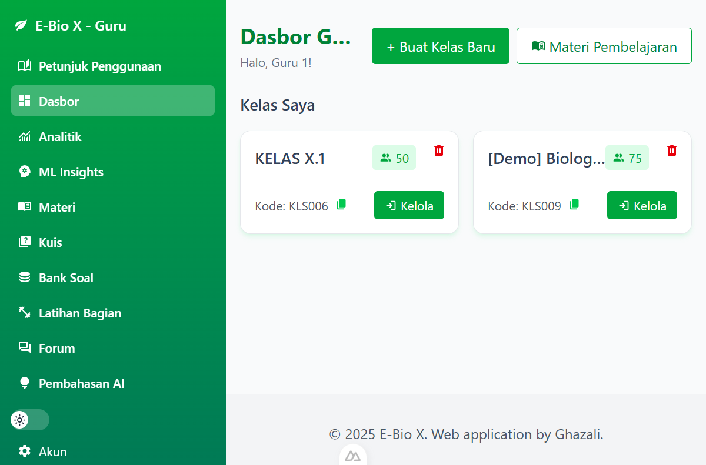
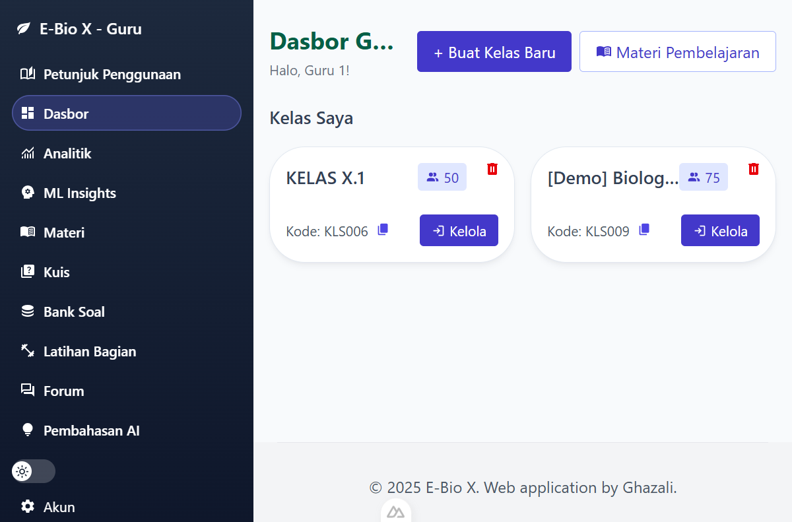
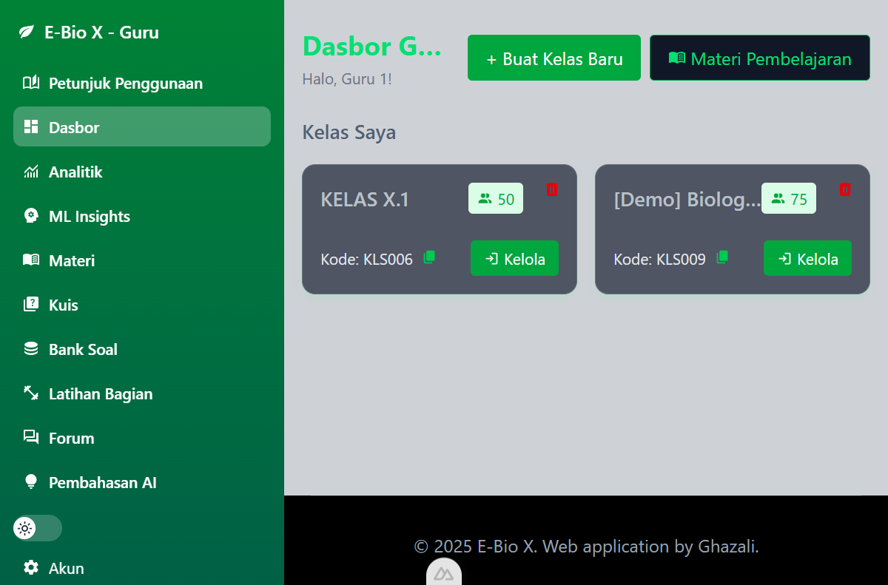
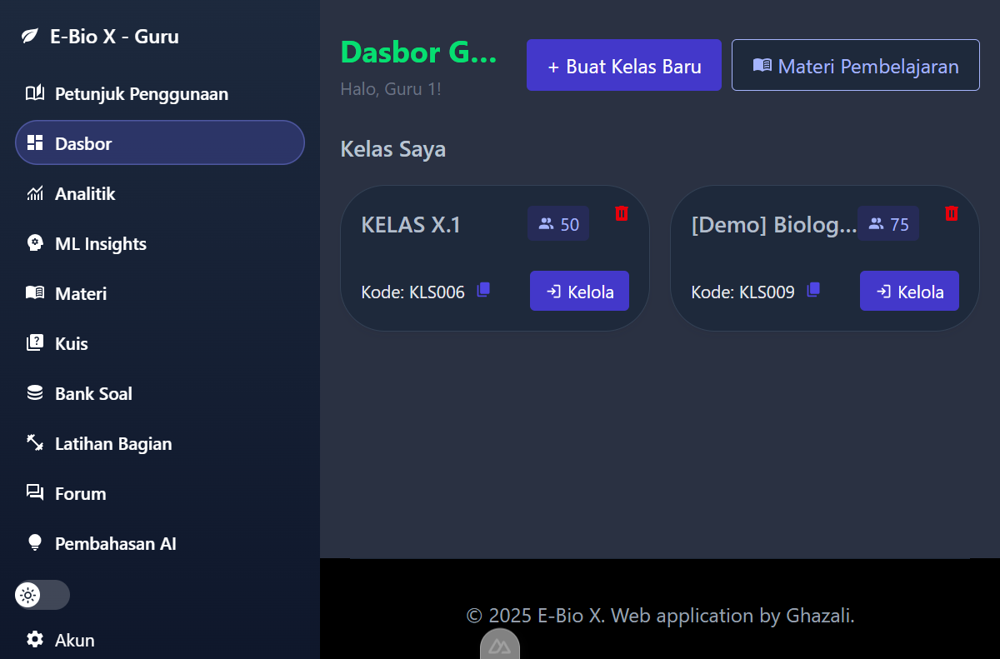

# Dokumentasi Perubahan Warna UI E-Bio X (Before / After)

Dokumen ini mencatat perubahan palet warna antarmuka **guru** dan **siswa**,
lengkap dengan bukti tangkapan layar **sebelum (before)** dan **sesudah (after)**
dari aplikasi yang berjalan di `http://localhost:3000`.

Semua tangkapan layar diambil pada ukuran jendela yang sama, dengan akun demo:

| Peran | Akun | Halaman |
| --- | --- | --- |
| Siswa | `murid1@ebiox.com` | `/student/dashboard` |
| Guru | `guru1@ebiox.com` | `/teacher` |
| Tamu | — | `/login` |

Setiap halaman dasbor diambil dalam mode **terang** dan **gelap** (toggle tema
di sidebar); halaman login diambil dalam mode terang.

---

## 1. Ringkasan perubahan

Tujuan perubahan: menghilangkan pemakaian hijau terang yang gagal kontras,
memisahkan warna **peran** (guru vs siswa), dan menyeragamkan permukaan
(background/kartu/garis) memakai token netral.

| Lapisan | Sebelum | Sesudah |
| --- | --- | --- |
| Merek / aksi utama | `green-500` / `green-600` (#22C55E / #16A34A) | `brand-700` (#047857) |
| Aksen guru | hijau, sama dengan siswa | **indigo** `guru-700` (#4338CA) + sidebar ink slate |
| Aksen siswa | hijau terang `green-600 → emerald-700` | **emerald** `siswa-700 → siswa-900` |
| Permukaan halaman | `gray-50` / `gray-800` (gelap) | `canvas` (#F8FAFC / #0F172A) |
| Kartu | `white` / `gray-900` (gelap) | `surface` (#FFFFFF / #1E293B) |
| Garis | `gray-200` / `gray-700` | `line` (#E2E8F0 / #334155) |
| Peringatan (CTA) | `amber-500` (#F59E0B) | `amber-700` (#B45309) |
| Aksen petunjuk | `indigo-600` (warna ke-4) | `brand-700` (dilebur ke aksi utama) |

### Skala warna baru

| Token | 50 | 100 | 500 | 600 | 700 | 800 | 900 |
| --- | --- | --- | --- | --- | --- | --- | --- |
| `brand` / `siswa` | #ECFDF5 | #D1FAE5 | #10B981 | #059669 | **#047857** | #065F46 | #064E3B |
| `guru` | #EEF2FF | #E0E7FF | #6366F1 | #4F46E5 | **#4338CA** | #3730A3 | #312E81 |

Warna semantik tetap: sukses `#15803D`, peringatan `#B45309`,
bahaya `#B91C1C` (kontras ≥ 5:1 dengan teks putih).

---

## 2. Perbandingan Before / After

### 2.1 Halaman login (mode terang)

| Sebelum | Sesudah |
| --- | --- |
|  |  |

Yang berubah:

- Header kartu: `bg-green-600` / `dark:bg-green-700` → **`bg-brand-700`** (#047857).
- Tombol **Login**: `bg-green-500` (#22C55E) → **`bg-brand-700`** (#047857).
  Kontras teks putih naik dari **2,28:1** (gagal) menjadi **5,48:1** (lulus AA).
- Cincin fokus input: `ring-green-500` → `ring-brand-500`.
- Latar halaman: `bg-white` → `bg-canvas` (#F8FAFC), kartu tetap putih.

### 2.2 Dasbor siswa — mode terang

| Sebelum | Sesudah |
| --- | --- |
|  |  |

Yang berubah:

| Elemen | Sebelum | Sesudah |
| --- | --- | --- |
| Sidebar | gradien `green-600 → emerald-700` | gradien **`siswa-700 → siswa-900`** |
| Menu aktif | `bg-white/25` | `bg-white/20` + garis tepi `white/25` |
| Kartu "Langkah Berikutnya" | garis `green-300`, latar `green-50` | `brand-300` / `brand-50` |
| Tombol **Latihan adaptif** | `bg-green-600` | **`bg-brand-700`** + hover `brand-800` |
| Kartu statistik | garis `green-200` | garis netral `line` |
| Progress bar | `bg-green-600` | **`bg-brand-700`** |
| Kartu rekomendasi | garis `green-200` | garis netral `line` |
| Tombol **Pelajari Sekarang** | `bg-green-600` | **`bg-brand-700`** |
| Tombol CTA peringatan | `bg-amber-500` (putih 2,15:1) | **`bg-amber-700`** (putih 5,02:1) |
| Tombol petunjuk/insight | `bg-indigo-600` | **`bg-brand-700`** (satu warna aksi) |
| Kartu & latar | `bg-gray-50` / `white` | `bg-canvas` / `bg-surface` |

### 2.3 Dasbor siswa — mode gelap

| Sebelum | Sesudah |
| --- | --- |
|  |  |

Yang berubah:

- Latar halaman: `dark:bg-gray-800` (#1F2937) → **`dark:bg-canvas`** (#0F172A).
- Kartu: `dark:bg-gray-900` → **`dark:bg-surface`** (#1E293B), sehingga kartu
  lebih terang dari halaman (elevasi terbaca, tidak lagi tenggelam).
- Garis kartu: `dark:border-gray-700` → `dark:border-line` (#334155).
- Sidebar tetap emerald gelap, menyatu dengan aksi utama.

### 2.4 Dasbor guru — mode terang

| Sebelum | Sesudah |
| --- | --- |
|  |  |

Yang berubah:

| Elemen | Sebelum | Sesudah |
| --- | --- | --- |
| Sidebar guru | gradien hijau (sama dengan siswa) | **ink slate** `slate-800 → slate-900` |
| Menu aktif | `bg-white/25` | `bg-guru-500/25` + cincin `guru-400/40` |
| Tombol **Buat Kelas Baru** | `bg-green-600` | **`bg-guru-700`** (#4338CA) |
| Tombol sekunder | garis & teks hijau | garis `guru-300`, teks `guru-700` |
| Lencana jumlah siswa | `bg-green-100 text-green-600` | `bg-guru-100 text-guru-700` |
| Tombol **Kelola** | `bg-green-600` | **`bg-guru-700`** |
| Ikon salin kode | `text-green-500` | `text-guru-600` |

Dengan ini guru dan siswa tidak lagi memakai warna yang sama: guru = indigo,
siswa = emerald.

### 2.5 Dasbor guru — mode gelap

| Sebelum | Sesudah |
| --- | --- |
|  |  |

Yang berubah: latar `dark:bg-gray-800` → `dark:bg-canvas`, kartu memakai
`bg-surface`, dan aksen tombol tetap indigo agar terbaca di latar gelap.

---

## 3. Hasil uji kontras (WCAG AA)

Ambang teks normal: **4,5:1**; teks besar/ikon: **3:1**.

| Pasangan warna | Sebelum | Sesudah | Status |
| --- | --- | --- | --- |
| Putih di atas tombol login (`green-500` → `brand-700`) | 2,28:1 ❌ | **5,48:1** ✅ | Lulus |
| Putih di atas tombol utama (`green-600` → `brand-700`) | 3,30:1 ❌ | **5,48:1** ✅ | Lulus |
| Putih di atas tombol guru (`guru-700`) | — | **7,90:1** ✅ | Lulus |
| Putih di atas CTA peringatan (`amber-500` → `amber-700`) | 2,15:1 ❌ | **5,02:1** ✅ | Lulus |
| Putih di atas bahaya (`red-500` → `red-600`) | 3,76:1 ❌ | **4,83:1** ✅ | Lulus |
| Teks utama mode gelap (`slate-100` di `slate-900`) | — | **16,30:1** ✅ | Lulus |
| Teks sekunder mode gelap (`slate-300` di `slate-900`) | — | **12,02:1** ✅ | Lulus |
| Teks hijau di latar `brand-50` | — | **5,21:1** ✅ | Lulus |
| Teks hijau di latar `brand-100` | — | **6,78:1** ✅ | Lulus |

Catatan: `brand-500` (#10B981, 3,77:1) **tidak** dipakai untuk teks putih;
hanya untuk batang progres/ikon dekoratif.

---

## 4. Berkas yang diubah

### Token & konfigurasi tema

- `e-bio-x-frontend/app/assets/css/main.css` — menambahkan `@theme` untuk
  `brand`, `guru`, `siswa`, serta permukaan `canvas/surface/line`; menggelapkan
  skala `green-500/600/700` agar sisa pemakaian lama langsung lolos kontras.
- `e-bio-x-frontend/app/app.config.ts` — **baru**; menetapkan
  `ui.colors.primary = "brand"` dan `ui.colors.neutral = "slate"`.

### Layout

- `layouts/student.vue`, `layouts/teacher.vue`, `layouts/admin.vue`,
  `layouts/default.vue`, `layouts/blank.vue` — latar halaman → `bg-canvas text-body`.

### Navigasi & komponen bersama

- `components/StudentSidebar.vue` — gradien emerald, tombol mobile, status aktif.
- `components/TeacherSidebar.vue` — sidebar ink slate, aksen indigo.
- `components/NavBar.vue` — gradien brand, menu guru indigo, drawer mobile.
- `components/AppCard.vue` — bayangan netral, `bg-surface`, `border-line`.
- `components/StatCard.vue` — ikon default `brand`.
- `utils/ui.ts` — warna status/penguasaan naik ke 600–700 (teks) dan
  `emerald-700` / `red-600` untuk heatmap.

### Halaman

- `pages/login.vue` — header & tombol `brand-700`, cincin fokus.
- `pages/student/dashboard.vue` — CTA, kartu, badge, progress, hierarki aksi.
- `pages/teacher/index.vue` — CTA & lencana indigo.
- `pages/teacher/analytics/index.vue` — heatmap penguasaan.
- `pages/teacher/quiz/explanations/index.vue` — tombol bahaya.
- `components/QuizList.vue`, `NotificationBell.vue`, `MaterialQuestionBlock.vue`
  — perbaikan kontras tombol/lencana kecil.

---

## 5. Cara memakai token baru

```vue
<!-- permukaan -->
<div class="bg-canvas text-body">
  <div class="bg-surface border border-line rounded-xl">
    <!-- aksi utama: satu warna per layar -->
    <button class="bg-brand-700 hover:bg-brand-800 text-white">Mulai</button>
    <!-- aksen guru -->
    <button class="bg-guru-700 hover:bg-guru-800 text-white">Kelola Kelas</button>
  </div>
</div>
```

Aturan singkat:

1. **Netral 60–70%** — `canvas`, `surface`, `line`, `text-body`.
2. **Peran/merek 20–30%** — sidebar, header, tombol utama, cincin fokus.
3. **Semantik ≤10%** — hanya untuk status (sukses/peringatan/bahaya/info).

Satu layar sebaiknya hanya punya **satu tombol solid**; aksi lain memakai
outline atau teks agar mata langsung tahu langkah utama.

---

## 6. Catatan pengambilan gambar

- Aplikasi dijalankan lokal: backend Flask `:5000`, frontend Nuxt `:3000`.
- Tangkapan layar diambil dengan `fullPage`, mode terang dan gelap, pada
  jendela peramban yang sama agar perbandingan adil.
- Data demo yang termuat pada setiap pengambilan adalah data yang sama; tinggi
  halaman kedua gambar identik (siswa 2252 px, guru 527 px).
